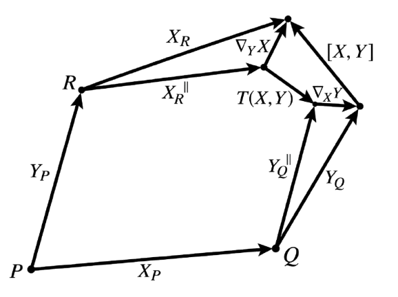

### Curvature Forms 

For a manifold endowed with a connection, we define the two mappings

$$
T(X,Y) = \nabla_X Y - \nabla_Y X - [X, Y]
$$

and,

$$
R(X,Y) = \nabla_X \nabla_Y - \nabla_Y \nabla_X - \nabla_{[X,Y]}
$$

where $X$ and $Y$ are two contravariant vector fields. These mappings are called torsion and curvature, respectively. Both are antisymmetric in their arguments.

### Cartan's First Form 

Torsion means does the connection behave symmetrically when we interchange $X$ and $Y$.

  

 
We have two vectors $X, Y$. The first term $\nabla_X Y$ means how does $Y$ change when we move in $X$ direction.  The second term $\nabla_Y X$ means how does $X$ change when we move in $Y$ direction. The third term $[X,Y]$ is the Lie bracket. 

Suppose that the connection were such that

$$
 \nabla_X Y - \nabla_Y X = [X, Y]
$$

Then,

$$
T(X, Y) = 0
$$

This is what happens for Levi-Civita connection. 

Now lets take the whole equation again,

$$
T(X,Y) = \nabla_X Y - \nabla_Y X - [X, Y]
$$

$X$ and $Y$ are vector fields on a manifold $M$.

$$
X = X^i \partial_i, \space Y = Y^j \partial_j
$$

For example in 2 dimensional space:

$$
X = X^x \frac{\partial}{\partial x} + X^y \frac{\partial}{\partial y}
$$

The covariant derivative of $Y$ in $X$ direction is $\nabla_X Y$. 

Why not just use $XY$? Because $Y$ is a vector not a scalar. For a scalar function $f$,

$$
Xf
$$

is easy to define. But for a vector field $Y$, vectors at different points belong to different tangent spaces:

$$
Y(p) \in T_pM, \space Y(q) \in T_qM
$$

So you cannot simply substract them $Y(p)-Y(q)$ without some rule for comparing them. The rule is the connection $\nabla$.

What does $\nabla_X Y$ look like in coordinates?

$$
X = X^k \partial_k, \space Y= Y^j \partial_j
$$

Then,

$$
\nabla_X Y = X^k (\partial_k Y^j + \Gamma^j_{lk} Y^l) \partial_j
$$

So the difference $\nabla_X Y - \nabla_Y X$ measures the antisymmetric part of the covariant derivative.

**Third Term: [X, Y]**

$$
[X, Y]f = X(Yf) - Y(Xf)
$$

for any scalar funtion $f$. It measures the failure of the flows of $X$ and $Y$ to commute. 

Therefore, 

$$
T(X,Y) = \text{asymmetric connection change - intrinsic non commutativity}
$$

***

General formula for the exterior derivative of a 1-form $\alpha$. 

$$
d\alpha(X, Y) = X[\alpha Y] - Y[\alpha X] - \alpha[X, Y]
$$

Now set $\alpha = e^j$

$$
de^j(X, Y) = X e^j(Y) - Y e^j(X) - e^j([X, Y])
$$

Therefore,

$$
T^j(X, Y) = de^j(X, Y) + \omega^j_l(X)e^l(Y) - \omega^j_l(Y)e^l(X)
$$

Recall the definition of wedge product

$$
(\alpha \wedge \beta)(X, Y) = \alpha(X)\beta(Y) - \alpha(Y)\beta(X)
$$

So,

$$
T^j(X, Y) = de^j(X, Y) + (\omega^j_l \wedge e^l)(X,Y)
$$

$$
T^j(X, Y) = (de^j + \omega^j_l \wedge e^l)(X,Y)
$$

Cartan's first equation of structure is compact way of saying torsion comes from two things: how basis itself changes, $de^j$ and how the connection changes the basis, $\omega^j_l \wedge e^l$.

### Cartan's Second Form 

The **curvature** by definition, we have

$$
R(X,Y)Z = \nabla_X \nabla_Y Z - \nabla_Y \nabla_X Z - \nabla_{[X,Y]} Z
$$

The expression on right hand side is linear in $X, Y, Z$.

$$
R(fX, Y)Z = R(X, fY)Z = fR(X, Y)Z
$$

and

$$
R(X, Y)fZ = fR(X, Y)Z
$$

where $f$ is an arbitrary function. Hence the mapping,

$$
R: T^1_0 \times T^1_0 \times T^1_0 \to T^1_0
$$

is a multilinear function of the arguments. Consequently, $R$ is a tensor field of type $(1,2)$: it is called the Riemann tensor.

Now, making use of known relations,

$$
\nabla_X \nabla_Y Z = \nabla_X \{ Ye^j(Z) + \omega^j_k(Y) e^k(Z) \} e_j
$$

$$
= [ Ye^l(Z) + \omega^l_k(Y) e^k(Z)] \nabla_X e_l + [XYe^j(Z) + X\{ \omega^j_k(Y) e^k(Z) \}]e_j
$$

$$
= [ Ye^l(Z) + \omega^l_k(Y) e^k(Z)] \omega^j_l (X) e_j + [XYe^j(Z) + e^l(Z)X\omega^j_l(Y) + \omega^j_l(Y) X e^l(Z)] e_j
$$

Consequently,

$$
\nabla_X \nabla_Y Z - \nabla_Y \nabla_X Z = \{ [X\omega^j_l(Y) - Y\omega^j_l(X) +\omega^j_k(X)\omega^k_l(Y) - \omega^j_k(Y) \omega^j_l(X)]e^l(Z) + [X,Y]e^j(Z)\}e_j
$$

We also have,

$$
\nabla_{[X, Y]} Z = \{ [X, Y]e^j(Z) + \omega^j_l([X,Y])e^l(Z) \} e_j
$$

Now, finally we get,

$$
R(X,Y)Z = \{ X \langle \omega^j_l, Y \rangle - Y  \langle \omega^j_l, X \rangle + \langle \omega^j_l, [X, Y] \rangle + \omega^j_k(X)\omega^k_l(Y) - \omega^j_k(Y) \omega^j_l(X)   \} e^l(Z) e_j
$$

Also making use of identity,

$$
\frac{1}{2} R(X,Y)Z = (d\omega^j_l + \omega^j_k \wedge \omega^k_l)(X, Y) e^l(Z) e_j
$$

Accordingly, if $\omega$ is any one-form,

$$
R(\omega, Z, X, Y) = R^j_{lkm}[e_j \otimes e^l \otimes (e^k \wedge e^m)](\omega, Z, X, Y)
$$

$$
= (R^j_{lkm} e^k \wedge e^m)(X, Y)e^l(Z)e_j(\omega)
$$

From a comparison of equations, we obtain relation

$$
\frac{1}{2} R^j_{lkm} e^k \wedge e^m = d\omega^j_l + \omega^j_k \wedge \omega^k_l
$$

Defining the two-form,

$$
\mathbf{\Omega}^j_l = d\omega^j_l + \omega^j_k \wedge \omega^k_l
$$

we have Cartan's second equation of structure:

$$
\frac{1}{2} R^j_{lkm} e^k \wedge e^m  = \mathbf{\Omega}^j_l
$$

In a local coordinate basis

$$
\omega^j_l = \Gamma^j_{lm} dx^m
$$

therefore,

$$
d\omega^j_l = \Gamma^j_{lm,n} dx^n \wedge dx^m = \frac{1}{2}(\Gamma^j_{lm,n} - \Gamma^j_{ln,m})dx^n \wedge dx^m 
$$

Also,

$$
\omega^j_k \wedge \omega^k_l = \Gamma^j_{kn} \Gamma^k_{lm} dx^n \wedge dx^m
$$

$$
= \frac{1}{2}( \Gamma^j_{kn} \Gamma^k_{lm} -  \Gamma^j_{km} \Gamma^k_{ln}) dx^n \wedge dx^m
$$

Accordingly, Cartan's second equation of structure is equivalent to the definition

$$
R^j_{lmn} = \Gamma^j_{lm,n} - \Gamma^j_{ln,m} + \Gamma^j_{kn} \Gamma^k_{lm} - \Gamma^j_{km} \Gamma^k_{ln}
$$

This is the Rienmann tensor as conventionally defined. 
